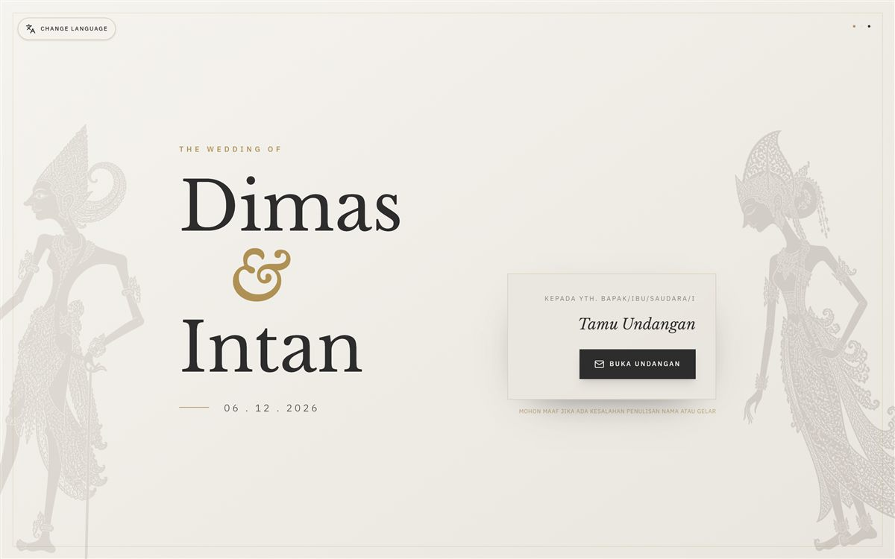
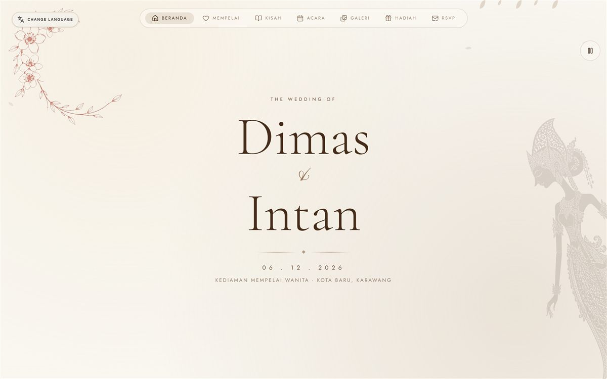
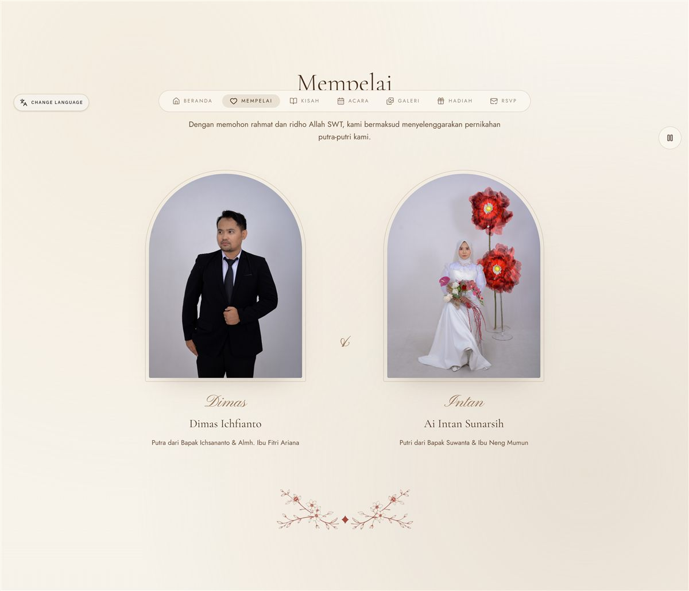
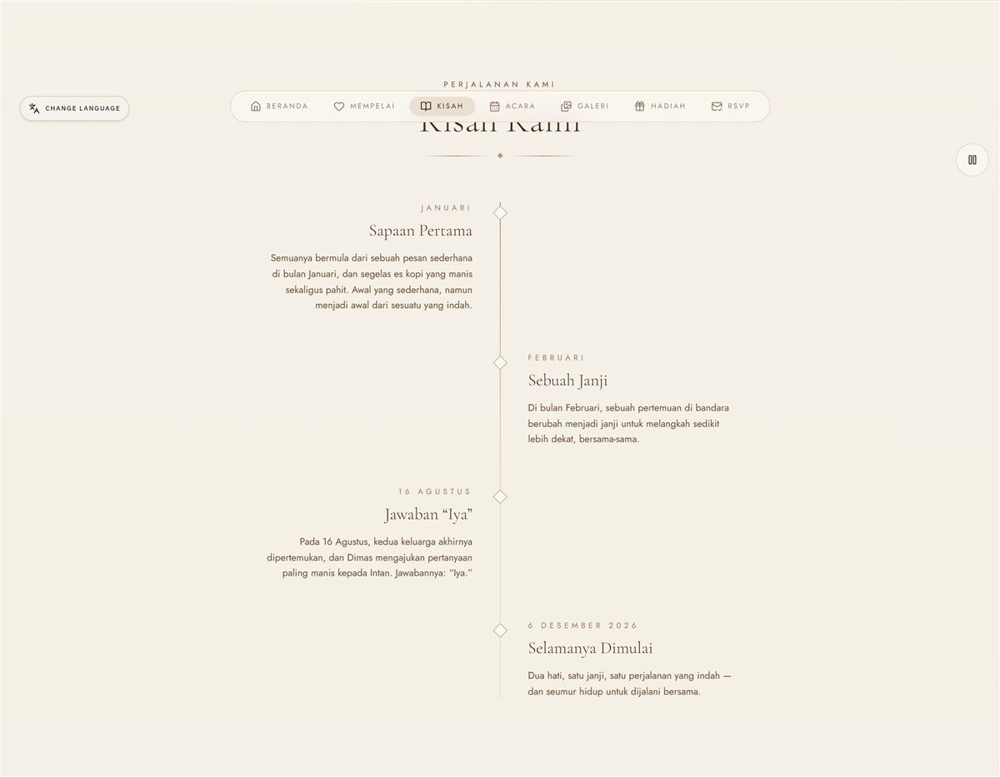
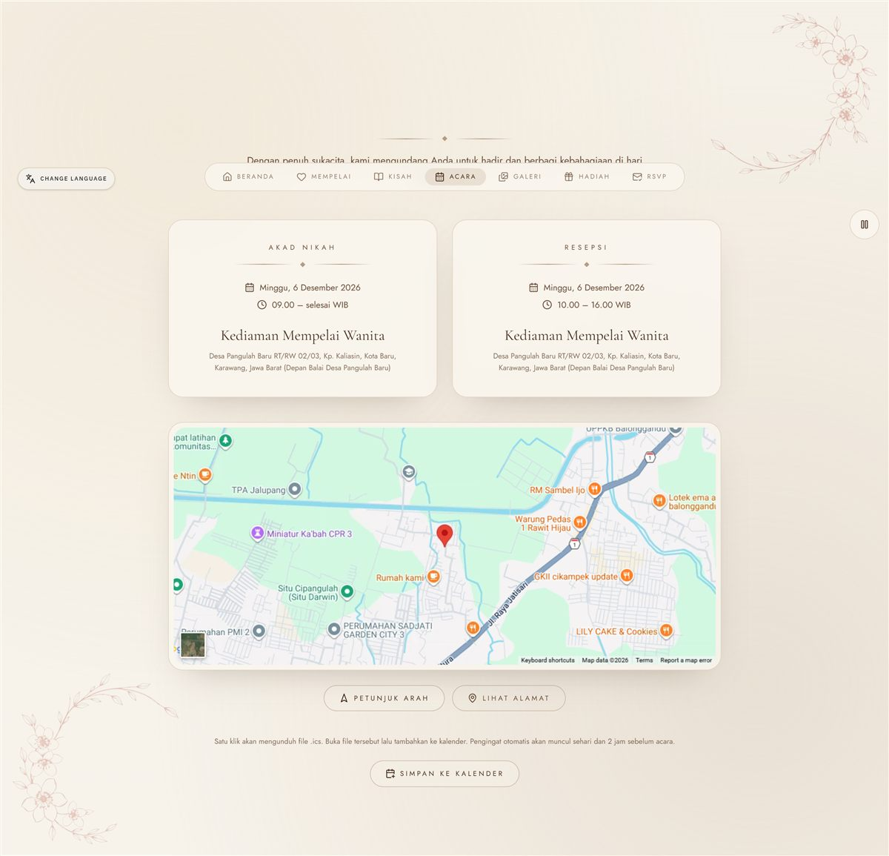
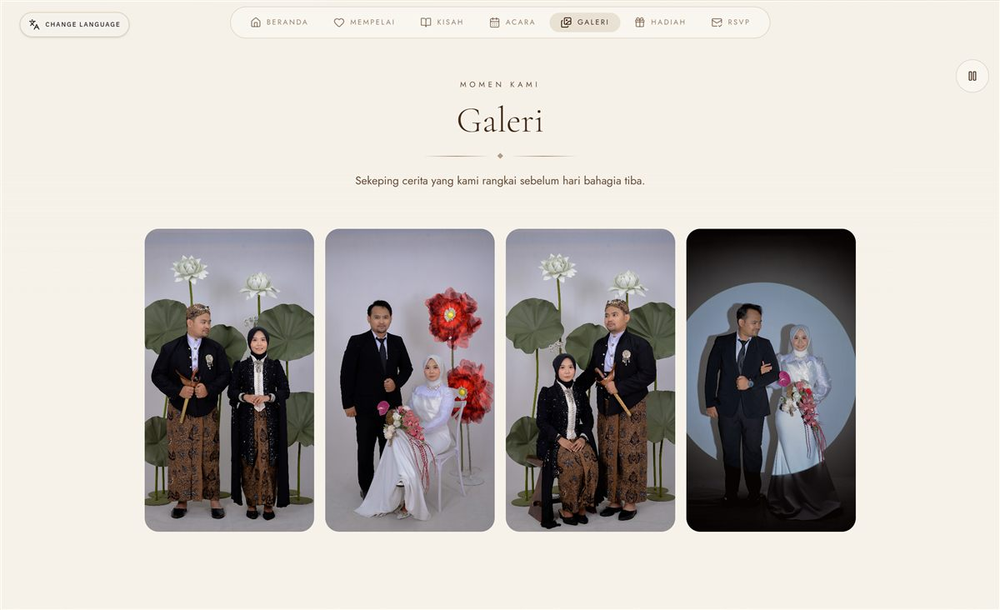
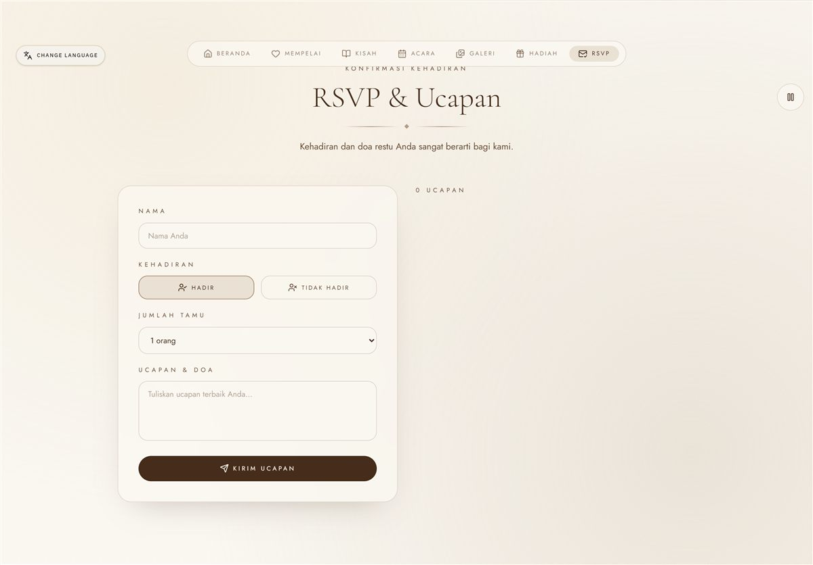
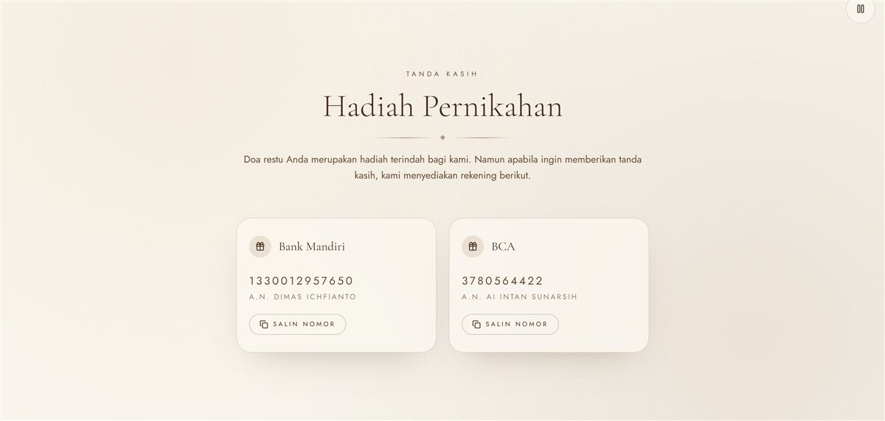

<div align="center">

# WebNikahV1

**Undangan pernikahan digital dwibahasa untuk Dimas & Intan.** Versi pertama — tema hangat *mocha, sand, champagne*: galeri, peta lokasi, RSVP realtime, dan pemutar musik.

[](https://dimasintan.vercel.app)




</div>

---

## About

Undangan satu halaman yang dibagikan lewat WhatsApp dengan link personal per tamu (`/nama-tamu`), sehingga nama tamu langsung muncul di layar pembuka. Ini **versi pertama** dengan palet hangat kecoklatan; penerusnya bertema emerald ada di [WebNikahV2](https://github.com/RizkyPutraIchfiandra/WebNikahV2).

**Yang bisa dilakukan tamu:**

- **Buka undangan** dari layar sampul, musik latar menyala mengikuti ketukan tombol.
- **Ganti bahasa** ID ⇄ EN kapan saja, termasuk tanggal panjang dan pesan WhatsApp.
- **Lihat rangkaian acara** akad & resepsi, plus simpan ke kalender lewat berkas `.ics`.
- **Buka lokasi** di peta OpenStreetMap atau lanjut ke Google Maps.
- **Kirim RSVP & ucapan** yang tampil langsung di buku tamu.
- **Salin nomor rekening** untuk hadiah, satu ketukan.

## Screens

<table>
<tr>
<td width="50%">


**Hero** — potret mempelai, tanggal, dan navigasi ke seluruh bagian.

</td>
<td width="50%">


**Mempelai** — profil kedua mempelai beserta nama orang tua.

</td>
</tr>
<tr>
<td width="50%">


**Love Story** — perjalanan hubungan dalam alur kronologis.

</td>
<td width="50%">


**Rangkaian Acara** — akad & resepsi, peta lokasi, tombol kalender.

</td>
</tr>
<tr>
<td width="50%">


**Galeri** — carousel foto dengan lightbox.

</td>
<td width="50%">


**RSVP & Ucapan** — konfirmasi kehadiran dan buku tamu.

</td>
</tr>
<tr>
<td width="50%">


**Hadiah** — kartu rekening Mandiri & BCA dengan tombol salin.

</td>
<td width="50%">

</td>
</tr>
</table>

## Built with

| Technology | What it does here |
| --- | --- |
| [TanStack Start](https://tanstack.com/start) + [TanStack Router](https://tanstack.com/router) | Kerangka full-stack dengan file-based routing dan server-side rendering. |
| [React](https://react.dev) 19 + [TypeScript](https://www.typescriptlang.org) 5 | Kerangka UI dengan tipe ketat. |
| [Nitro](https://nitro.build) | Server runtime hasil build, siap deploy ke Vercel maupun Cloudflare. |
| [Vite](https://vite.dev) 8 | Build tool dan dev server. |
| [Tailwind CSS](https://tailwindcss.com) 4 | Styling utility, palet hangat didefinisikan sebagai token `oklch`. |
| [shadcn/ui](https://ui.shadcn.com) + [Radix UI](https://www.radix-ui.com) | Komponen dasar yang mudah diakses: dialog, carousel, form, tooltip. |
| [Motion](https://motion.dev) | Transisi masuk antar bagian dan animasi kartu. |
| [Embla Carousel](https://www.embla-carousel.com) | Carousel galeri dengan dukungan swipe. |
| [React Hook Form](https://react-hook-form.com) + [Zod](https://zod.dev) | Formulir RSVP beserta validasinya. |
| [Leaflet](https://leafletjs.com) + OpenStreetMap | Peta lokasi tanpa API key. |
| [SheetJS](https://sheetjs.com) | Impor/ekspor Excel di generator link tamu. |
| [Vercel](https://vercel.com) | Hosting hasil build Nitro. |

## Getting started

### Prerequisites

- [Bun](https://bun.sh) 1.1+ (atau Node.js 20+ dengan `npm`)

### 1. Install

```bash
git clone https://github.com/RizkyPutraIchfiandra/WebNikahV1.git
cd WebNikahV1
bun install
```

### 2. Run

```bash
bun run dev
```

Data acara (nama, tanggal, lokasi, rekening) ada di satu berkas: [`src/data/weddingConfig.ts`](src/data/weddingConfig.ts).

### 3. Build

```bash
bun run build
bun run preview   # pratinjau hasil build
```

## Link tamu

Satu link personal per tamu — nama otomatis muncul di sampul undangan.

```
https://dimasintan.vercel.app/suparmini
https://dimasintan.vercel.app/bu-ati
```

Buka `/buat-link` untuk membuat link massal dari berkas Excel daftar tamu.

## Project structure

```
.
├── docs/
│   └── screens/                Screenshot untuk README
├── src/
│   ├── components/
│   │   ├── OpeningScreen/      Layar sampul + tombol "Buka Undangan"
│   │   ├── Hero/               Hero potret mempelai
│   │   ├── Countdown/          Hitung mundur hari H
│   │   ├── Couple/             Profil kedua mempelai
│   │   ├── LoveStory/          Love Story kronologis
│   │   ├── EventDetails/       Rangkaian acara + peta Leaflet
│   │   ├── Gallery/            Carousel Embla + lightbox
│   │   ├── RSVP/               Formulir RSVP & buku tamu
│   │   ├── Gift/               Kartu rekening + tombol salin
│   │   ├── MusicPlayer/        Pemutar musik latar
│   │   ├── FloralDecorations/  Ornamen bunga SVG
│   │   ├── Quote/              Kutipan ayat
│   │   ├── Closing/            Bagian penutup
│   │   ├── Navigation/         Navigasi atas & bilah bawah
│   │   ├── LanguageButton/     Pengalih bahasa ID/EN
│   │   ├── common/             Komponen bersama
│   │   └── ui/                 shadcn/ui primitives
│   ├── data/weddingConfig.ts   Sumber tunggal data acara
│   ├── hooks/                  use-mobile, dll
│   ├── lib/
│   │   ├── i18n.tsx            Kamus & context dwibahasa ID/EN
│   │   ├── guestbook.ts        Penyimpanan RSVP & ucapan
│   │   ├── guestSlug.ts        Slug tamu ⇄ nama
│   │   └── utils.ts            Helper className
│   ├── routes/
│   │   ├── index.tsx           Halaman undangan
│   │   ├── $guest.tsx          Rute link tamu /nama-tamu
│   │   ├── buat-link.tsx       Generator link tamu
│   │   └── __root.tsx          Shell + halaman galat
│   ├── server.ts               Entry server (Nitro)
│   ├── start.ts                Entry client
│   └── styles.css              Design token palet hangat
└── vite.config.ts              Konfigurasi build
```

## Scripts

| Command | What it does |
| --- | --- |
| `bun run dev` | Jalankan dev server |
| `bun run build` | Build produksi (Nitro) |
| `bun run preview` | Pratinjau hasil build |
| `bun run lint` | ESLint |
| `bun run format` | Prettier |

## License

Dibuat untuk acara pribadi Dimas & Intan. Silakan jadikan referensi; ganti data di `src/data/weddingConfig.ts` dan foto di `src/assets` kalau mau dipakai ulang.
